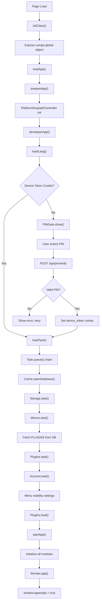
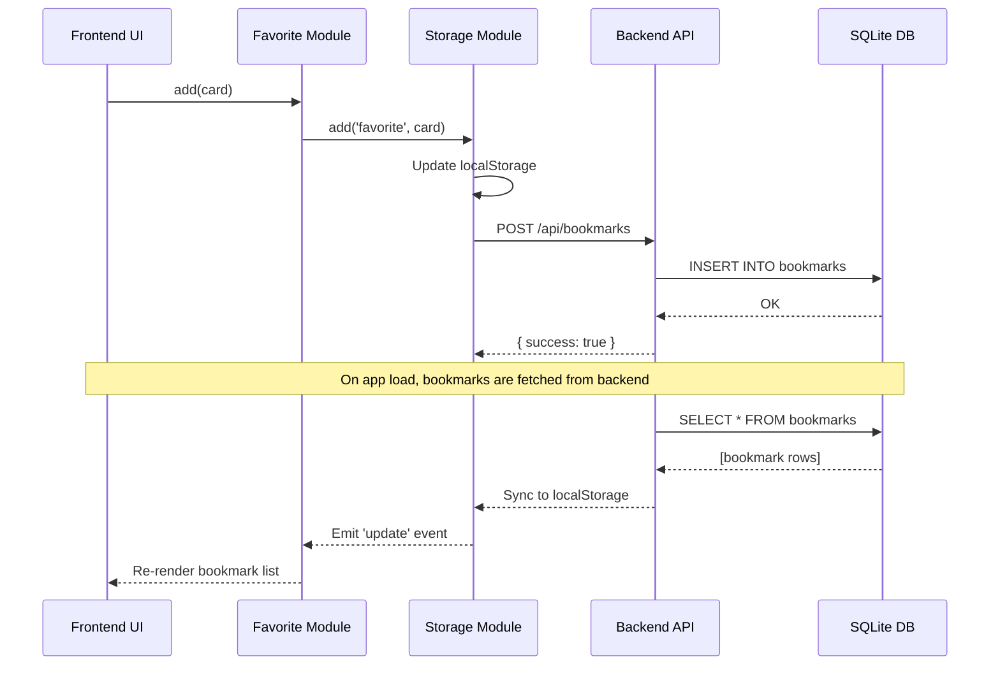
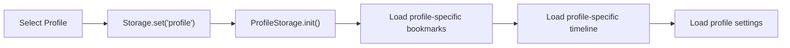
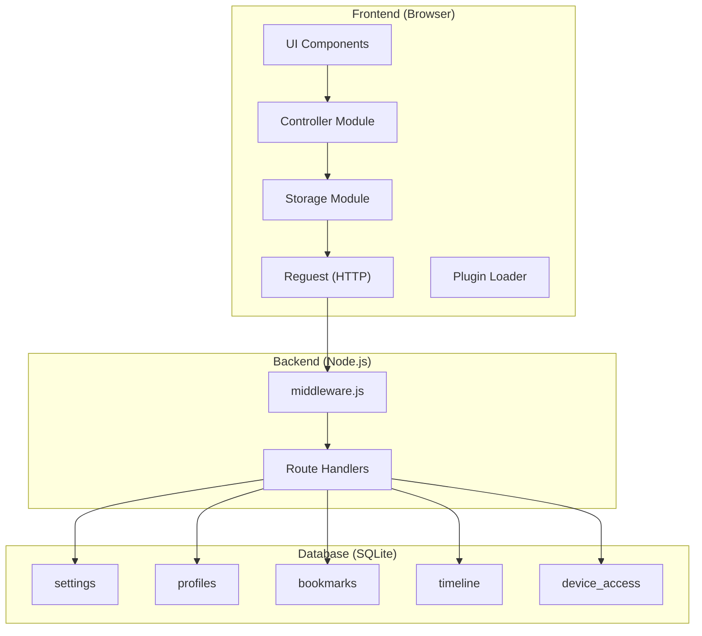

# Lampa Project - AI Context Documentation

> **Purpose**: This document provides comprehensive context for AI coding assistants working on the Lampa project. It describes the architecture, logic flows, and development patterns to enable accurate code generation and modifications.

---

## Table of Contents

1. [Project Overview & Goal](#project-overview--goal)
2. [Tech Stack & Dependencies](#tech-stack--dependencies)
3. [Directory Structure](#directory-structure)
4. [Key Logic Flows](#key-logic-flows)
5. [Logic Mapping](#logic-mapping)
6. [Development Guidelines](#development-guidelines)

---

## Project Overview & Goal

**Lampa** is a self-hosted media center application designed for Smart TVs, set-top boxes, and web browsers. It provides a unified interface for browsing movies and TV shows, managing favorites, tracking watch progress, and integrating with external services like TorrServer.

### Core Features
| Feature | Description |
|---------|-------------|
| **Media Browsing** | Browse movies/TV shows from TMDB with rich metadata |
| **Multi-Profile Support** | Multiple user profiles with isolated bookmarks and timelines |
| **Bookmark Sync** | Synchronize favorites/watch progress to local SQLite backend |
| **PIN Gate Security** | Device-level access control via PIN verification |
| **Plugin System** | Extensible architecture for custom plugins and sources |
| **Admin Panel** | Web-based administration for settings, devices, and profiles |
| **Cross-Platform** | Runs on WebOS, Tizen, Android TV, browsers, and more |

### Account Provider Modes
- **`local`** (default): All data stored in local SQLite database via Express-like backend
- **`cub`**: Cloud synchronization with CUB (external service)

---

## Tech Stack & Dependencies

### Frontend Stack
| Technology | Purpose |
|------------|---------|
| **JavaScript (ES6+)** | Core application logic with ES6 modules |
| **jQuery** | DOM manipulation and AJAX requests |
| **SASS/SCSS** | Stylesheets with nested rules and variables |
| **Rollup** | Module bundler for ES6 → IIFE output |
| **Babel** | Transpilation for broad browser compatibility |

### Backend Stack
| Technology | Purpose |
|------------|---------|
| **Node.js** | Server runtime |
| **Browser-Sync** | Development server with live reload |
| **SQLite3** | Persistent storage via `sqlite3` package |
| **Express-style Middleware** | Custom middleware in `backend/middleware.js` |
| **Cookie-Parser** | Session and device token management |
| **Speakeasy** | TOTP support for 2FA (optional) |

### Build System
| Tool | Purpose |
|------|---------|
| **Gulp 4** | Task runner for build pipeline |
| **gulp-sass** | SCSS → CSS compilation |
| **gulp-uglify-es** | JavaScript minification |
| **gulp-autoprefixer** | CSS vendor prefixes |

### Key Dependencies (from package.json)
```json
{
  "dependencies": {
    "sqlite3": "^5.1.7",
    "body-parser": "^2.2.1",
    "cookie-parser": "^1.4.7",
    "speakeasy": "^2.0.0",
    "redis": "^4.0.2"
  },
  "devDependencies": {
    "gulp": "^4.0.0",
    "rollup": "~2.58.0",
    "sass": "^1.43.4",
    "vitest": "^0.32.4"
  }
}
```

---

## Directory Structure

```
lampa-source/
├── .env                          # Environment variables (HOST, PORT, DB_PATH)
├── .env.example                  # Template for environment configuration
├── package.json                  # NPM dependencies and scripts
├── gulpfile.js                   # Build pipeline (Gulp 4)
├── database.sqlite               # SQLite database file (auto-created)
│
├── backend/                      # Server-side logic
│   ├── database.js               # SQLite connection, schema migrations (v1-v7)
│   ├── middleware.js             # Request routing, device token guard
│   ├── ip-utils.js               # Client IP extraction utilities
│   ├── rate-limit.js             # Rate limiting for PIN attempts
│   ├── settings_keys.js          # Centralized setting key constants
│   └── routes/                   # API route handlers
│       ├── admin.js              # Admin panel API (device management)
│       ├── auth.js               # Admin login/logout
│       ├── backup.js             # User data backup/restore
│       ├── bookmarks.js          # CRUD for bookmarks (favorites)
│       ├── data.js               # Key-value settings API
│       ├── pin.js                # PIN verification endpoint
│       ├── profile_settings.js   # Per-profile settings storage
│       ├── profiles.js           # Profile CRUD operations
│       ├── settings.js           # Global settings management
│       └── timeline.js           # Watch progress (timecodes)
│
├── src/                          # Frontend source code
│   ├── app.js                    # ★ Application entry point
│   │
│   ├── core/                     # Core application modules
│   │   ├── controller.js         # Focus/navigation controller (TV remote support)
│   │   ├── keypad.js             # Keyboard/remote event handling
│   │   ├── layer.js              # UI layer management (modals, overlays)
│   │   ├── platform.js           # Platform detection (Tizen, WebOS, Android)
│   │   ├── plugins.js            # Plugin loader and executor
│   │   ├── favorite.js           # Favorites/bookmark management
│   │   ├── router.js             # URL-based navigation
│   │   ├── socket.js             # WebSocket for real-time sync
│   │   ├── storage/              # Storage abstraction
│   │   │   ├── storage.js        # LocalStorage wrapper with caching
│   │   │   └── profile_storage.js# Profile-specific storage
│   │   ├── account/              # Account management (CUB/local)
│   │   ├── api/                  # API client wrappers
│   │   │   └── sources/          # TMDB, parser, AI sources
│   │   └── tmdb/                 # TMDB API integration
│   │
│   ├── components/               # Page components (views)
│   │   ├── full.js               # Full card view (movie/show details)
│   │   ├── main.js               # Main page component
│   │   ├── torrents.js           # Torrent search results
│   │   ├── bookmarks.js          # Bookmarks listing
│   │   ├── timetable.js          # Release calendar
│   │   └── full/                 # Sub-components for detail pages
│   │
│   ├── interaction/              # UI interaction modules
│   │   ├── activity/             # Activity/screen management
│   │   ├── player.js             # Video player controller
│   │   ├── player/               # Player sub-modules (panel, playlist, etc.)
│   │   ├── pin_gate.js           # ★ PIN entry UI with keyboard
│   │   ├── scroll.js             # Scrollable list implementation
│   │   ├── modal.js              # Modal dialogs
│   │   ├── select.js             # Selection menus
│   │   ├── card.js               # Card rendering (movie/show items)
│   │   ├── settings/             # Settings UI components
│   │   ├── search/               # Search functionality
│   │   └── menu/                 # Navigation menu
│   │
│   ├── services/                 # Background services
│   │   ├── db_values.js          # Fetch settings from backend DB
│   │   ├── settings.js           # Settings sync service
│   │   ├── torrserver.js         # TorrServer integration
│   │   ├── watched.js            # Watch history tracking
│   │   └── remote_favorites.js   # Remote bookmark sync
│   │
│   ├── utils/                    # Utility functions
│   │   ├── reguest.js            # HTTP request wrapper (with device token)
│   │   ├── subscribe.js          # Event pub/sub system
│   │   ├── arrays.js             # Array manipulation helpers
│   │   ├── constants.js          # Shared constant keys (SETTINGS_KEYS)
│   │   └── db.js                 # IndexedDB wrapper for caching
│   │
│   ├── templates/                # HTML templates (jQuery-based)
│   ├── lang/                     # Internationalization (*.js files)
│   ├── sass/                     # SCSS stylesheets
│   └── admin/                    # Admin panel frontend
│       └── index.html            # Admin panel HTML
│
├── public/                       # Static assets (copied to build)
│   ├── css/                      # Compiled CSS
│   ├── img/                      # Images and icons
│   └── fonts/                    # Web fonts
│
├── build/                        # Build output directory
│   └── web/                      # Web build (served by Browser-Sync)
│
├── index/                        # Platform-specific index files
│   ├── webos/                    # LG WebOS package files
│   ├── tizen/                    # Samsung Tizen package files
│   └── github/                   # GitHub Pages deployment
│
└── plugins/                      # External plugins source
```

---

## Key Logic Flows

### 1. Application Startup Sequence

The application entry point is `src/app.js`. The startup follows this sequence:



**Key Functions**:
- `prepareApp()`: Initializes platform, keypad, controller, and basic UI
- `checkDevice()`: Validates device token or shows PIN Gate
- `loadTask()`: Queued initialization using `Task.queue()`
- `startApp()`: Final initialization of all services and rendering

---

### 2. PIN Gate Security Flow

The PIN Gate protects the application from unauthorized access. Implementation spans frontend and backend.

#### Frontend: `src/interaction/pin_gate.js`

```javascript
// Shows PIN entry keyboard
// Collects 4-digit PIN from user
// Sends POST to /api/pin/verify with { pin, device_id }
// On success: receives token, stores in cookie, calls callback
// On failure: shows error message
```

#### Backend: `backend/routes/pin.js`

```javascript
// POST /api/pin/verify
// 1. Rate limit check (per-IP)
// 2. Validate PIN against stored value
// 3. If valid:
//    - Generate device token
//    - Store token_hash in device_access table
//    - Set device_token cookie (httpOnly)
//    - Return { success: true }
// 4. If invalid:
//    - Increment attempt counter
//    - Return { success: false, error: 'invalid_pin' }
```

#### Middleware Guard: `backend/middleware.js`

All `/api/*` routes (except `/api/pin/verify`) are protected:

```javascript
// 1. Extract device_token from cookie
// 2. Hash token and query device_access table
// 3. If status !== 'allowed': reject with 401
// 4. Update last_seen_at timestamp
// 5. Proceed to route handler
```

---

### 3. Bookmark Synchronization Flow

Bookmarks (favorites) sync between frontend localStorage and backend SQLite.



**Database Table**: `bookmarks`
```sql
CREATE TABLE bookmarks (
    id INTEGER PRIMARY KEY AUTOINCREMENT,
    profile_id INTEGER NOT NULL,
    type TEXT NOT NULL,          -- 'movie', 'tv', 'like', 'history', etc.
    card_id INTEGER NOT NULL,    -- TMDB ID
    data TEXT NOT NULL,          -- JSON card data
    updated_at INTEGER NOT NULL
);
```

---

### 4. Profile Management Flow

Profiles allow multiple users with isolated data.



**Database Table**: `profiles`
```sql
CREATE TABLE profiles (
    id INTEGER PRIMARY KEY AUTOINCREMENT,
    name TEXT NOT NULL,
    icon TEXT,
    is_main INTEGER DEFAULT 0,
    is_child INTEGER DEFAULT 0,
    sort_order INTEGER DEFAULT 0,
    created_at INTEGER NOT NULL,
    updated_at INTEGER NOT NULL
);
```

---

### 5. Settings Configuration Flow

Settings are managed at two levels:
1. **Global settings**: Stored in `settings` table, affect all profiles
2. **Profile settings**: Stored in `profile_settings`, per-profile preferences

```javascript
// Frontend: src/services/db_values.js
ServiceDbValues.get(SETTINGS_KEYS.PLUGINS, (value) => {
    // Use the setting value
});

// Backend: backend/routes/data.js
// GET /api/values?keys=key1,key2,key3
// Returns: { key1: value1, key2: value2, ... }
```

**Setting Keys** (from `src/utils/constants.js`):
```javascript
const SETTINGS_KEYS = {
    TORRSERVER_URL: 'torrserver_url',
    JACKETT_URL: 'jackett_url',
    MENU_INTERFACE: 'menu_interface',
    MENU_PARSER: 'menu_parser',
    HEAD_SEARCH: 'head_search',
    PLUGINS: 'plugins',
    // ... more keys
};
```

---

## Logic Mapping

### Component Relationships



### Data Flow Matrix

| Action | Frontend Module | API Endpoint | Backend Route | DB Table |
|--------|-----------------|--------------|---------------|----------|
| Login (PIN) | `pin_gate.js` | `POST /api/pin/verify` | `routes/pin.js` | `device_access` |
| Add Favorite | `core/favorite.js` | `POST /api/bookmarks` | `routes/bookmarks.js` | `bookmarks` |
| Update Timeline | `interaction/timeline.js` | `POST /api/timeline` | `routes/timeline.js` | `timeline` |
| Create Profile | `components/settings/` | `POST /api/profiles` | `routes/profiles.js` | `profiles` |
| Get Settings | `services/db_values.js` | `GET /api/values` | `routes/data.js` | `settings` |
| Admin: List Devices | `admin/index.html` | `GET /api/admin/devices` | `routes/admin.js` | `device_access` |

### Module Dependencies (Frontend)

```
app.js (Entry Point)
├── core/controller.js    ← Focus management for TV remotes
├── core/storage/storage.js ← LocalStorage + IndexedDB caching
├── core/platform.js      ← Platform detection
├── core/plugins.js       ← Plugin system
├── interaction/pin_gate.js ← Security gate
├── interaction/activity/activity.js ← Screen stack management
├── services/db_values.js ← Settings from backend
└── utils/reguest.js      ← HTTP with device_token header
```

---

## Development Guidelines

### 1. Controller Pattern (Focus Management)

The application uses a custom focus controller for TV remote navigation. Always use the `Controller` module for focusable elements:

```javascript
import Controller from './core/controller';

// Register a new controller
Controller.add('my_component', {
    toggle: () => { /* Called when this controller becomes active */ },
    back: () => { /* Handle back button */ },
    enter: () => { /* Handle enter/OK button */ },
    left: () => { /* Handle left arrow */ },
    right: () => { /* Handle right arrow */ },
    up: () => { /* Handle up arrow */ },
    down: () => { /* Handle down arrow */ }
});

// Activate the controller
Controller.toggle('my_component');
```

### 2. Storage Pattern

Use the `Storage` module for persisted data. It wraps `localStorage` with caching and sync capabilities:

```javascript
import Storage from './core/storage/storage';

// Get value (with default)
const theme = Storage.get('theme', 'dark');

// Set value
Storage.set('theme', 'light');

// Listen for changes
Storage.listener.follow('change', (event) => {
    if (event.name === 'theme') {
        applyTheme(event.value);
    }
});
```

### 3. Event Pattern (Subscribe)

Use the `Subscribe` pattern for pub/sub events:

```javascript
import Subscribe from './utils/subscribe';

const listener = Subscribe();

// Subscribe to events
listener.follow('update', (data) => {
    console.log('Updated:', data);
});

// Emit events
listener.send('update', { key: 'value' });

// Unsubscribe
listener.remove('update');
```

### 4. API Request Pattern

Use the `Reguest` module for HTTP requests. It automatically includes the `device_token` cookie:

```javascript
import Reguest from './utils/reguest';

const network = new Reguest();

network.clear();
network.json(`/api/bookmarks`, {
    profile_id: 1
}, (data) => {
    console.log('Bookmarks:', data);
}, (error) => {
    console.error('Failed:', error);
});
```

### 5. Adding New Backend Routes

1. Create route handler in `backend/routes/`:
```javascript
// backend/routes/my_feature.js
function handle(req, res) {
    if (req.method === 'GET') {
        // Handle GET
    } else if (req.method === 'POST') {
        // Handle POST
    }
}

module.exports = { handle };
```

2. Register in `backend/middleware.js`:
```javascript
const myFeatureParams = require('./routes/my_feature');

// In handleRoutes():
else if (req.url.startsWith('/api/my-feature')) {
    myFeatureParams.handle(req, res);
}
```

### 6. Adding New Settings Keys

1. Add to `backend/settings_keys.js`:
```javascript
module.exports = {
    // ... existing keys
    MY_NEW_KEY: 'my_new_key'
};
```

2. Mirror in `src/utils/constants.js`:
```javascript
const SETTINGS_KEYS = {
    // ... existing keys
    MY_NEW_KEY: 'my_new_key'
};
```

3. Initialize default value in `backend/database.js`:
```javascript
safeRun(
    db,
    `INSERT INTO settings(key, value, visible) VALUES(?, 'default_value', 1) ON CONFLICT(key) DO NOTHING`,
    [SETTINGS_KEYS.MY_NEW_KEY]
);
```

### 7. Database Migrations

Schema changes use versioned migrations in `backend/database.js`:

```javascript
if (version < 8) {
    safeRun(db, `
        CREATE TABLE IF NOT EXISTS new_table (
            id INTEGER PRIMARY KEY AUTOINCREMENT,
            ...
        )
    `);
    setVersion(8);
}
```

> **IMPORTANT**: Always increment the version number and wrap migrations in version checks. Never modify existing migrations.

### 8. Build Commands

| Command | Description |
|---------|-------------|
| `npm run start` | Start dev server with live reload (port 9118) |
| `npm run build` | Build for production |
| `npm run debug` | Build with source maps |
| `npm test` | Run tests with Vitest |
| `npm run doc` | Generate documentation |

### 9. Environment Variables

Configure via `.env`:
```bash
HOST=0.0.0.0       # Server host
PORT=3000          # Server port (Browser-Sync uses 9118)
DB_PATH=./database.sqlite  # SQLite database path
```

---

## Quick Reference

### Key Files to Modify

| Task | Primary File(s) |
|------|-----------------|
| Add new page/component | `src/components/`, `src/interaction/activity/` |
| Modify navigation | `src/core/controller.js`, `src/interaction/menu/` |
| Add new API endpoint | `backend/routes/`, `backend/middleware.js` |
| Change database schema | `backend/database.js` |
| Add new setting | `backend/settings_keys.js`, `src/utils/constants.js` |
| Modify PIN Gate | `src/interaction/pin_gate.js`, `backend/routes/pin.js` |
| Add new plugin | `plugins/` directory |
| Modify admin panel | `src/admin/index.html`, `backend/routes/admin.js` |

### Global Objects

| Object | Location | Purpose |
|--------|----------|---------|
| `window.Lampa` | Exposed by `app.js` | Access to all core modules |
| `window.lampa_settings` | Defined in `app.js` | Application configuration |
| `window.appready` | Set in `startApp()` | Indicates app initialization complete |
| `Navigator` | External library | TV-style spatial navigation |

---

*Last Updated: 2026-02-02*
